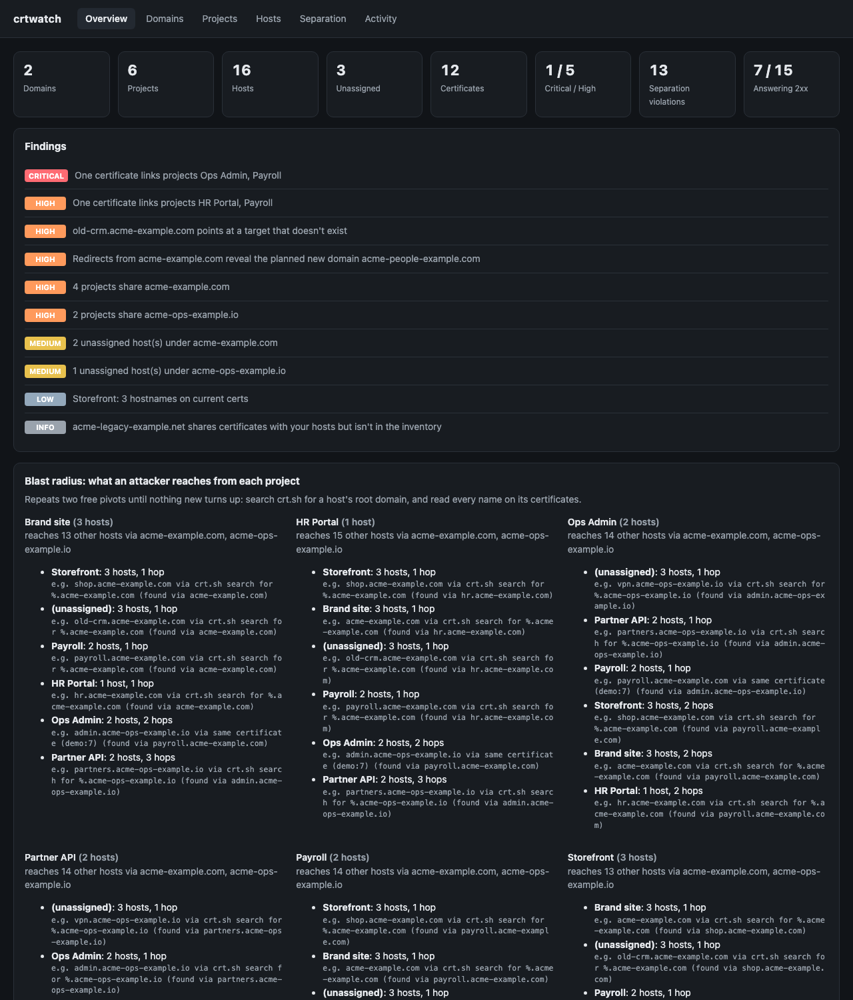
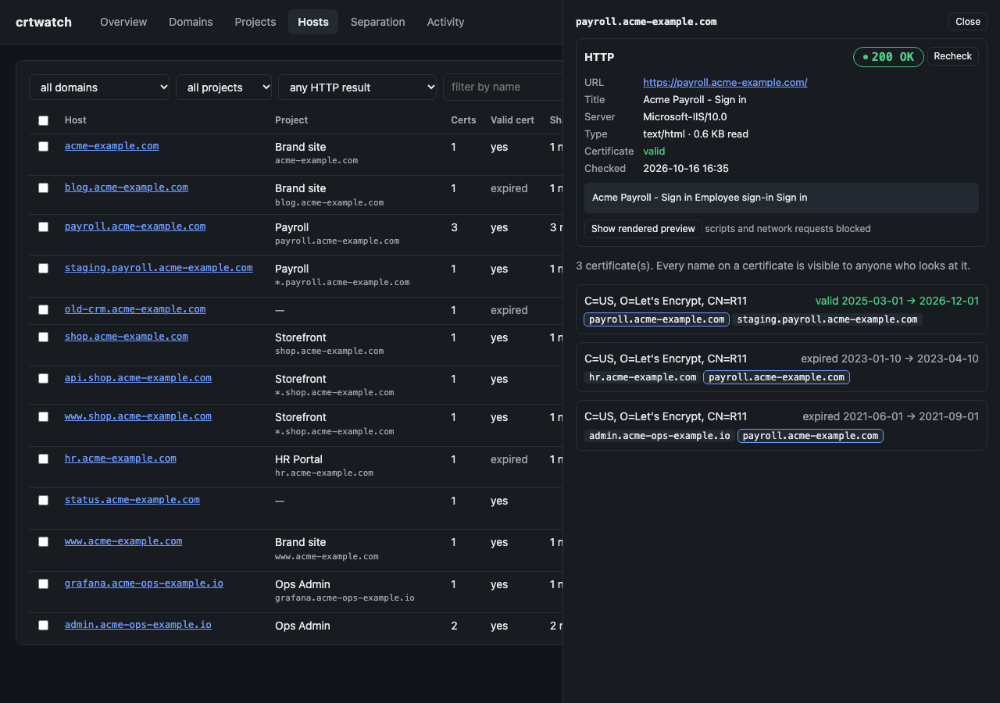

# 🔍 crtwatch

**See your domains the way an attacker does, find out which of your projects give each other away, and plan how to separate them.**



---

## 🤔 What problem does this solve?

Every HTTPS certificate ever issued is written into public logs called **Certificate Transparency (CT)**. Anyone can search them for free, for example on [crt.sh](https://crt.sh).

Picture this:

> 🕵️ An attacker stumbles on `shop.yourcompany.com`.
> They search crt.sh for `yourcompany.com` and get a list of **every** hostname you've ever had a certificate for: `payroll.yourcompany.com`, `vpn.yourcompany.com`, `staging-admin.yourcompany.com`…
> One of those certificates also lists `admin.your-other-domain.io`. Now they know about that domain too.

So one project that's easy to find can expose projects you meant to keep out of sight, especially ones that ended up on the same domain by accident.

**crtwatch** reads the same public logs for your domains, works out which hostnames belong to which project, and follows the same trail an attacker would. Then it tells you:

- 🗺️ **What's out there**: every hostname under your domains, and which project it belongs to.
- 💥 **Blast radius**: if someone finds project A, what else can they reach, and how.
- 🚧 **Separation problems**: which projects can be "seen together" when they shouldn't be.
- 🔀 **A rotation plan**: which projects to move to a new domain, which old hostnames to shut down, and which names are "burned" for good.
- 🌐 **HTTP check**: visits each hostname and shows what answers, with colour-coded status codes, page titles, redirect chains, certificate problems and a safe preview of the page.
- ✅ **New-domain checks**: whether a domain you're about to use already has a public history that links it to you.
- 🔔 **Monitoring**: alerts in Slack or Discord when new hostnames or certificates show up.

Apart from the optional HTTP check, it only reads **public** data. No account, no API key, no cloud service: it all runs on your own computer or server.

---

## 🚀 Try it in 5 minutes

You need **Python 3.10 or newer**. Not sure if you have it? See [Getting started → Step 1](docs/getting-started.md#step-1-check-that-you-have-python).

**1. Install** (macOS / Linux):

```bash
python3 -m venv ~/crtwatch-env
```

```bash
~/crtwatch-env/bin/pip install git+https://github.com/kelvinnn/crtwatch.git
```

On Windows, open **PowerShell** and use these two commands instead:

```powershell
py -m venv $HOME\crtwatch-env
```

```powershell
& $HOME\crtwatch-env\Scripts\pip install git+https://github.com/kelvinnn/crtwatch.git
```

No `git` installed? Download the `.whl` file from the latest release on the [Releases page](https://github.com/kelvinnn/crtwatch/releases), then run the `pip install` command with the path to that file instead of the GitHub URL.

**2. Load the demo company** (made-up data, nothing is scanned):

```bash
~/crtwatch-env/bin/crtwatch --db demo.db demo
```

**3. Open the dashboard:**

```bash
~/crtwatch-env/bin/crtwatch --db demo.db serve
```

Now open **http://127.0.0.1:8080** in your browser and click around 🎉. Press `Ctrl+C` in the terminal to stop it.

> 💡 On Windows (PowerShell), replace `~/crtwatch-env/bin/crtwatch` with `& $HOME\crtwatch-env\Scripts\crtwatch`.

When you're ready to use it on your own domains, follow **[📘 Getting started](docs/getting-started.md)**. It walks through every step with screenshots.

---

## 📸 A quick look

| | |
|---|---|
| **Hosts**: every hostname, its project, DNS status and HTTP status code with the page title<br> | **Host details**: what answers (status, redirects, server, certificate), a text preview, and every certificate the name appears on<br> |
| **Separation**: which projects can be seen together, and the exact trail an attacker would follow<br> | **Overview**: all findings and each project's blast radius<br> |

---

## 📚 Documentation

| Guide | Read it when… |
|---|---|
| 📘 [Getting started](docs/getting-started.md) | You're new. Step-by-step from installing to reading your first rotation plan. |
| 📗 [User guide](docs/guide.md) | You want every command, setting, the CSV import format, alerts or the API. |
| 📙 [How it works](docs/how-it-works.md) | You want to know exactly how the data is collected and the results are worked out. |
| 📝 [Changelog](CHANGELOG.md) | You want to see what changed between versions. |

---

## 🖥️ Where should I run it?

- **Trying it out or checking now and then:** your own laptop is perfect.
- **Monitoring all the time:** a small always-on Linux server (a basic VPS is plenty) with Docker. See [Running it all the time](docs/getting-started.md#running-it-all-the-time).
- **Not on Vercel or other "serverless" hosting.** Scans can take minutes, the data needs a permanent disk, and crt.sh limits how many requests one IP address can make, and serverless platforms share their IP addresses between many customers.

---

## 🔒 Keep your results private

The database crtwatch builds is a **map of your attack surface**, including the names you're trying to hide. Treat it like a password file:

- By default the dashboard only listens on your own computer (`127.0.0.1`).
- To open it to a network you must set a password (`CRTWATCH_PASSWORD`). crtwatch refuses to start otherwise.
- Never commit your `data/` folder or `*.db` files to git. The included `.gitignore` already excludes them.
- The **HTTP check is the only feature that connects to your servers**, and it only runs when you ask for it. It skips hosts on private or internal addresses unless you allow them.

---

## 🧪 Running the tests

From a copy of this repository:

```bash
python -m unittest discover -s tests
```

The tests use made-up data and need no internet connection.

---

## 📄 Licence

Proprietary. All rights reserved; for internal use only. See [LICENSE](LICENSE).
