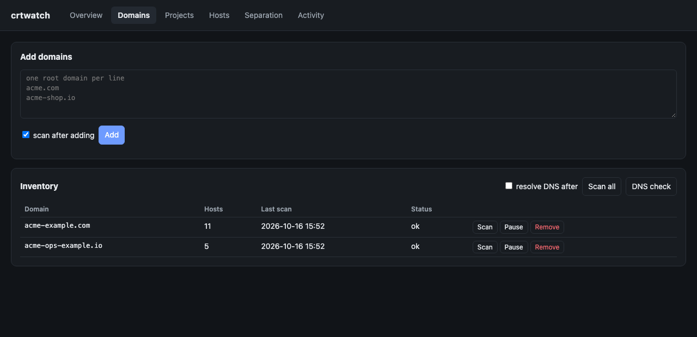
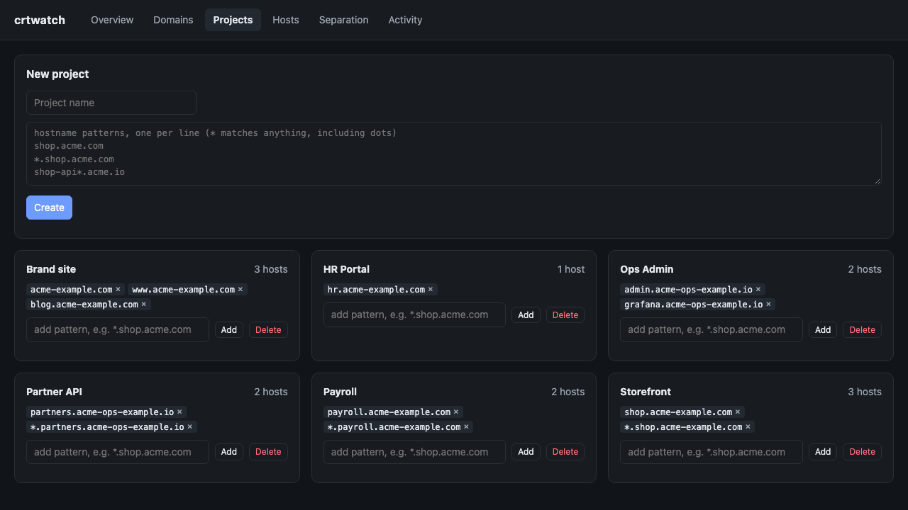
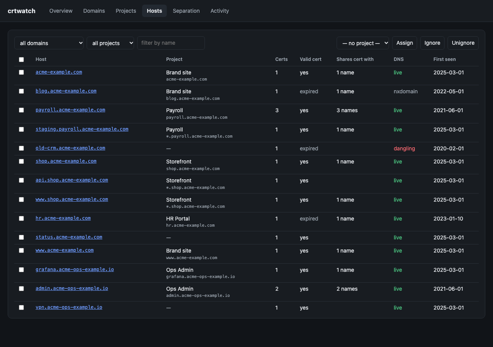
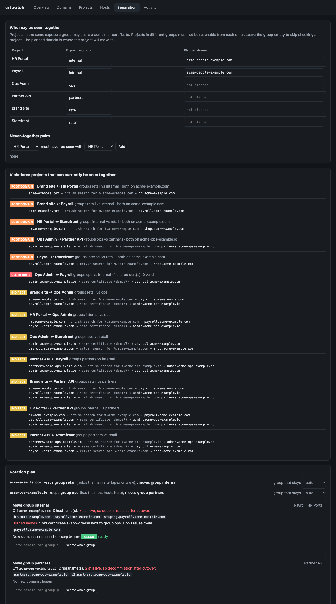
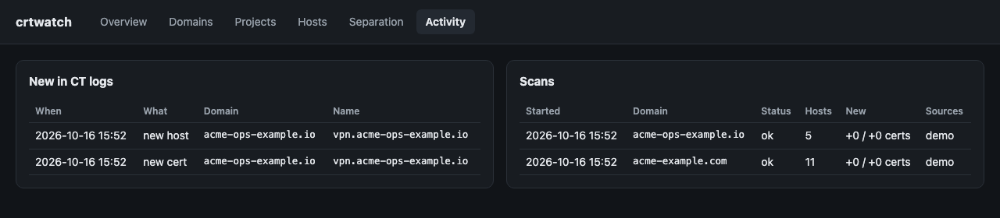

# 📘 Getting started with crtwatch

This guide takes you from nothing to a finished rotation plan for your own domains. No security or programming background needed: just follow the steps in order. ☕ Allow about 30 minutes for a first run.

**Contents**

1. [Check that you have Python](#step-1-check-that-you-have-python)
2. [Install crtwatch](#step-2-install-crtwatch)
3. [Try the demo (optional)](#step-3-try-the-demo-optional)
4. [Start your own inventory](#step-4-start-your-own-inventory)
5. [Add your domains](#step-5-add-your-domains)
6. [Tell crtwatch about your projects](#step-6-tell-crtwatch-about-your-projects)
7. [Sort out the leftovers](#step-7-sort-out-the-leftovers)
8. [Check which hostnames are still live](#step-8-check-which-hostnames-are-still-live)
9. [Decide who may be seen together](#step-9-decide-who-may-be-seen-together)
10. [Read the violations](#step-10-read-the-violations)
11. [Follow the rotation plan](#step-11-follow-the-rotation-plan)
12. [Keep watching](#step-12-keep-watching)

Also: [Running it all the time](#running-it-all-the-time) · [Updating](#updating) · [Starting over or uninstalling](#starting-over-or-uninstalling) · [Glossary](#glossary) · [Common questions](#common-questions)

---

## Step 1: Check that you have Python

crtwatch is written in Python and needs **version 3.10 or newer**.

Open a terminal:

- 🍎 **macOS**: press `Cmd+Space`, type *Terminal*, press Enter.
- 🪟 **Windows**: press the Start button, type *PowerShell*, press Enter.
- 🐧 **Linux**: you probably know where it is 😉.

Then type this and press Enter:

```bash
python3 --version
```

On Windows, type `py --version` instead.

✅ If you see `Python 3.10` or a higher number (3.11, 3.12, 3.13…), you're good. Go to Step 2.

❌ If you get "command not found", or a version below 3.10, install Python:

- 🍎 **macOS**: download the installer from [python.org/downloads](https://www.python.org/downloads/) and run it. (Homebrew users can run `brew install python` instead.)
- 🪟 **Windows**: download the installer from [python.org/downloads](https://www.python.org/downloads/). On the first screen of the installer, **tick "Add python.exe to PATH"**, then click *Install Now*.
- 🐧 **Ubuntu/Debian**: `sudo apt install python3 python3-venv`.

Close the terminal, open a new one, and check the version again.

---

## Step 2: Install crtwatch

You'll install crtwatch into its own little box, called a *virtual environment*, so it can't interfere with anything else on your computer.

### 🍎 macOS and 🐧 Linux

```bash
python3 -m venv ~/crtwatch-env
```

```bash
~/crtwatch-env/bin/pip install git+https://github.com/kelvinnn/crtwatch.git
```

To use the short `crtwatch` command in this terminal window, *activate* the environment:

```bash
source ~/crtwatch-env/bin/activate
```

### 🪟 Windows (PowerShell)

```powershell
py -m venv $HOME\crtwatch-env
```

```powershell
& $HOME\crtwatch-env\Scripts\pip install git+https://github.com/kelvinnn/crtwatch.git
```

To use the short `crtwatch` command in this window, activate the environment:

```powershell
& $HOME\crtwatch-env\Scripts\Activate.ps1
```

> 💡 If Windows says running scripts is disabled, skip activating. Type the full path every time instead, e.g. `& $HOME\crtwatch-env\Scripts\crtwatch --version`.

### No `git` on your computer?

The install command above needs `git`. Without it:

1. Go to the [Releases page](https://github.com/kelvinnn/crtwatch/releases) and download **`crtwatch-1.0.0-py3-none-any.whl`**.
2. Run the same `pip install` command, but with the path to the downloaded file instead of the GitHub address, e.g. `~/crtwatch-env/bin/pip install ~/Downloads/crtwatch-1.0.0-py3-none-any.whl`.

### Check it worked

```bash
crtwatch --version
```

You should see `crtwatch 1.0.0`. 🎉

> 📌 **Every time you open a new terminal**, activate the environment again (the `source …` or `Activate.ps1` line) before using `crtwatch`. If you forget, you'll get "command not found". The rest of this guide assumes it's activated.

---

## Step 3: Try the demo (optional)

The demo loads a made-up company called *Acme*, with two domains, six projects and some typical mistakes, so you can look around before scanning anything real:

```bash
crtwatch --db demo.db demo
```

```bash
crtwatch --db demo.db serve
```

Open **http://127.0.0.1:8080** in your browser. Click through the tabs; the rest of this guide explains what each one shows. When you're done, go back to the terminal and press `Ctrl+C` to stop.

`--db demo.db` keeps the demo in its own file, so it never mixes with your real data. You can delete `demo.db` whenever you like.

---

## Step 4: Start your own inventory

Pick a folder where crtwatch should keep its data, for example a new folder called `crtwatch` in your home folder:

```bash
mkdir -p ~/crtwatch && cd ~/crtwatch
```

On Windows: `mkdir $HOME\crtwatch; cd $HOME\crtwatch`

Then start the dashboard:

```bash
crtwatch serve
```

Open **http://127.0.0.1:8080**. It's empty for now.

📁 Your data is saved in `data/crtwatch.db` inside this folder. **Always start crtwatch from the same folder**, or you'll get a fresh, empty database. Alternatively, always pass the same `--db` path.

---

## Step 5: Add your domains

Click the **Domains** tab.



1. In the box, type your domains, **one per line**. Add the *main* domain (`yourcompany.com`), not individual hostnames (`shop.yourcompany.com`): attackers always search the main domain.
2. Leave **scan after adding** ticked and click **Add**.

A bar appears under the menu showing what's happening ("querying the crt.sh database…") and how long it's taken. Domains are scanned one after another.

⏱️ **How long does it take?** Small domains take seconds. Domains with thousands of certificates can take a few minutes. When a scan finishes, a ✓ message tells you how many hostnames and certificates were found.

> 🤷 **A scan failed?** crt.sh is a free community service and is sometimes overloaded. crtwatch automatically retries and falls back to other sources. If it still fails, click **Scan** on that domain later. See [Common questions](#common-questions).

---

## Step 6: Tell crtwatch about your projects

A **project** is one product, app or system: "Online shop", "Payroll", "Partner portal". crtwatch decides which hostnames belong to which project using **patterns**.

Click the **Projects** tab.



1. Type a project name.
2. Type its patterns, one per line.
3. Click **Create**.

### ✏️ Writing patterns

| Pattern | Matches | Doesn't match |
|---|---|---|
| `shop.acme.com` | exactly `shop.acme.com` | `www.shop.acme.com` |
| `*.shop.acme.com` | `www.shop.acme.com`, `api.shop.acme.com`, `a.b.shop.acme.com` | `shop.acme.com` itself |
| `shop-*.acme.com` | `shop-api.acme.com`, `shop-staging.acme.com` | `shop.acme.com` |

Tips:

- You usually want **two patterns per project**: the name itself and `*.` in front of it (`shop.acme.com` and `*.shop.acme.com`).
- `*` matches anything, **including dots**, so it can match more than you expect. Check the Hosts tab afterwards.
- If two patterns match the same hostname, the more specific one wins. An exact name always beats a pattern with `*`.

> 📋 **Lots of projects?** Put them in a spreadsheet with the columns `project, pattern, group, domain`, save it as CSV, and run `crtwatch import yourfile.csv`. See [Importing from CSV](guide.md#importing-a-mapping-from-csv).

---

## Step 7: Sort out the leftovers

Click the **Hosts** tab. This lists every hostname found, which project it belongs to, and more.



1. Set the second dropdown to **(unassigned)** to see only hostnames no pattern matched.
2. Tick the hostnames that belong to one project, choose that project in the dropdown on the right, and click **Assign**.
3. Hostnames that **aren't yours**, such as a vendor's name that ended up on a shared certificate: tick them and click **Ignore**.
4. **Click any hostname** to see every certificate it has appeared on, and every other name on those certificates. This shows exactly what an attacker sees.

What the columns mean:

| Column | Meaning |
|---|---|
| **Certs** | How many certificates have included this hostname. |
| **Valid cert** | *yes* = at least one certificate is still valid today; *expired* = only old ones. |
| **Shares cert with** | How many *other* names appeared on the same certificates. These are links an attacker can follow. |
| **DNS** | Filled in after Step 8. |
| **First seen** | When the hostname first appeared on a certificate. |

Don't worry about getting everything perfect; you can come back any time.

---

## Step 8: Check which hostnames are still live

CT logs keep names **forever**, even for things you shut down years ago. To tell what still works from what's just history, go to the **Domains** tab and click **DNS check**.

Back in **Hosts**, the **DNS** column now shows:

| Value | Meaning |
|---|---|
| 🟢 `live` | The name still points somewhere. |
| `nxdomain` | The name no longer exists. Only history. |
| `no_address` | The name exists but doesn't point to a server. |
| 🔴 `dangling` | **Fix this first.** The name points to a third-party service that no longer exists. Someone else could claim that service and take over your hostname (a "subdomain takeover"). Remove the DNS record. |

---

## Step 9: Decide who may be seen together

This is the heart of crtwatch. Click the **Separation** tab.



At the top, give each project an **exposure group**: just a label you type in.

- Projects with the **same** label are **allowed** to be linked. Example: your shop and your marketing site are both public, so both get `public`.
- Projects with **different** labels must **never** be discoverable from each other. Example: `payroll` gets `internal`, the partner portal gets `partners`.
- Leave a project's group **empty** if you don't care who sees it with what.

Need an exception, such as two projects in different areas that must never meet? Use **Never-together pairs** below the table.

> 🧠 **Rule of thumb:** ask yourself, "If an attacker found project A, would it be bad if they also found project B?" If yes, give them different groups.

---

## Step 10: Read the violations

The **Violations** section lists every pair of projects that can currently be seen together but shouldn't be, with the exact trail an attacker would follow. Each one has a label:

| Label | What it means | Example |
|---|---|---|
| 🟧 **ROOT DOMAIN** | Both projects live under the same main domain, so one crt.sh search shows both. | `shop.acme.com` and `payroll.acme.com` |
| 🟥 **CERTIFICATE** | At some point one certificate listed both projects' hostnames. That link is public **forever**, even if they're on different domains. | one old certificate for `payroll.acme.com` and `admin.acme-ops.io` |
| 🟨 **INDIRECT** | No direct link, but a chain of the two above connects them. | shop → (same domain) → payroll → (same certificate) → ops admin |

Read each trail from left to right. Every arrow is one free, public lookup.

---

## Step 11: Follow the rotation plan

Below the violations, the **Rotation plan** tells you what to do.

**1. Which group stays and which moves.** For each main domain with a clash, one group stays and the others move to a new domain. crtwatch keeps the group that owns the main website (`yourcompany.com` / `www`). If it picks wrong, change **group that stays**.

**2. For each group that moves, crtwatch lists:**

- 🔴 **Still live**: the hostnames you'll need to switch off on the old domain *after* you've moved.
- 🔥 **Burned names**: hostnames that old certificates already show next to a project they must stay apart from. **Never use these names again**, not even on the new domain.

**3. Choose and check a new domain:**

1. Think of a new domain that doesn't obviously belong to you.
2. Type it in **Vet a new domain** and click **Check**:
   - ✅ `clean`: never had a certificate. Good to go.
   - ⚠️ `has_history`: it's had certificates before (common for second-hand domains). Look at what was there.
   - ❌ `linked`: a certificate already ties it to your domains. **Pick another.**
3. Type it in **new domain for group …** and click **Set for whole group**. The plan then checks it doesn't land next to a project it must avoid.

**4. Do the move,** following the checklist at the bottom of the page. The most important rules:

- 🚫 **Don't redirect** old hostnames to the new domain. A redirect tells every visitor where you went.
- 🚫 **Never put old and new names on the same certificate.**
- ✅ Use a **wildcard certificate** (`*.newdomain.com`) on the new domain, so individual hostnames stop showing up in the logs.
- ✅ After the move, **delete the DNS records** of the old hostnames.

> ⚠️ **What moving can't do:** the old names stay in the logs forever. Someone who finds project A will still see that project B *used to* exist. The goal is that those old names are dead ends with no path to B's new home.

**5. When you're done,** add the new domain on the Domains tab, update the project's patterns, and check the Separation tab again.

---

## Step 12: Keep watching

New certificates can quietly re-link projects, for example when someone requests one certificate covering two sites. To catch that:

- Leave crtwatch running with automatic rescans: `crtwatch serve --every 6h`.
- New hostnames and certificates show up in the **Activity** tab:



- 🔔 **Get alerts in Slack or Discord:** create an *incoming webhook* in Slack or Discord, then start crtwatch with it:

```bash
CRTWATCH_WEBHOOK_URL="https://hooks.slack.com/services/..." crtwatch serve --every 6h
```

For Discord, also add `CRTWATCH_WEBHOOK_FORMAT=discord`. On Windows (PowerShell), set it first with `$env:CRTWATCH_WEBHOOK_URL="https://..."`, then run `crtwatch serve --every 6h`.

The first scan of each domain is its *baseline* and sends no alerts. You only hear about things that are new after that.

---

## Running it all the time

A laptop only monitors while it's switched on. For round-the-clock monitoring, use a small always-on Linux server with **Docker**.

1. Install Docker: see [docs.docker.com/get-docker](https://docs.docker.com/get-docker/).
2. Download the code:

   ```bash
   git clone https://github.com/kelvinnn/crtwatch.git && cd crtwatch
   ```

3. Create your settings file and set a password:

   ```bash
   cp .env.example .env
   ```

   Open `.env` in a text editor, replace `change-me` with a long random password, and optionally paste your webhook URL.

4. Start it:

   ```bash
   docker compose up -d --build
   ```

crtwatch now runs in the background, rescans every 6 hours, and keeps its data in the `data/` folder. It only listens on the server itself (`127.0.0.1:8080`). To reach it from your laptop, the simplest safe way is an SSH tunnel:

```bash
ssh -L 8080:127.0.0.1:8080 you@your-server
```

Then open http://127.0.0.1:8080 on your laptop and log in with any username and your password.

Useful Docker commands: `docker compose logs -f` (see what it's doing), `docker compose down` (stop it), `docker compose up -d --build` (start or update it).

---

## Updating

```bash
~/crtwatch-env/bin/pip install --upgrade git+https://github.com/kelvinnn/crtwatch.git
```

Your data is kept, and older databases are upgraded automatically. With Docker: `git pull`, then `docker compose up -d --build`.

## Starting over or uninstalling

- **Start over:** stop crtwatch and delete the `data/crtwatch.db` file (or whatever you passed to `--db`).
- **Uninstall:** delete the `crtwatch-env` folder, and your data folder if you no longer need it.

---

## Glossary

| Word | Meaning |
|---|---|
| **Certificate** | What makes the padlock appear in the browser. Each one lists the hostnames it's valid for. |
| **Certificate Transparency (CT)** | Public, permanent logs of every certificate issued. Anyone can search them. |
| **crt.sh** | A free website and database for searching CT logs. crtwatch uses it. |
| **Domain / main domain** | `yourcompany.com`. Technically the *registrable domain*: the part you buy from a registrar. |
| **Hostname** | A full name such as `shop.yourcompany.com`. |
| **Wildcard certificate** | A certificate for `*.yourcompany.com`. It covers any hostname without naming them, so it leaks less. |
| **Project** | One product or system. You define these. |
| **Exposure group** | A label: projects with the same label may be linked; different labels must not be. |
| **Violation** | Two projects that must not be linked, but are. |
| **Blast radius** | Everything an attacker can reach from one project. |
| **Burned name** | A hostname that old certificates have already publicly linked to the wrong project. |
| **Dangling CNAME** | A DNS record pointing to a service that no longer exists. A takeover risk. |
| **Baseline** | The first scan of a domain. Only things found after it count as "new". |

---

## Common questions

**Is this legal? Am I "hacking" anything?**
crtwatch only reads public certificate logs and asks public DNS servers about hostnames. It never connects to your servers, or anyone else's. That said, use it on domains you own or are responsible for.

**A scan says `crtsh_pg failed`.**
crt.sh's database is busy, or your network blocks outgoing connections on port 5432 (some office networks do). crtwatch falls back to other sources automatically, but those can miss some cross-domain links. Try again later or from another network for complete results.

**It's been running for minutes. Is it stuck?**
Look at the bar under the menu: it shows the current step and a timer. Big domains can take several minutes. If the timer keeps going for more than 15 minutes, stop crtwatch (`Ctrl+C`), start it again, and rescan that domain.

**Everything is "unassigned".**
Patterns must match the whole hostname. `shop.acme.com` doesn't match `www.shop.acme.com`; add `*.shop.acme.com` too.

**I see names that aren't mine.**
Hosting companies and CDNs sometimes put many customers on one certificate. Tick those names in **Hosts** and click **Ignore**.

**`refusing to listen on a public interface`**
You tried to make the dashboard reachable from other computers without a password. Set `CRTWATCH_PASSWORD` first, or keep the default (your own computer only).

**Where is my data, and how do I back it up?**
Run `crtwatch -h`: the `--db` line shows the file. Copy that file somewhere safe; that's the whole backup.

Still stuck? See the full [User guide](guide.md) or [How it works](how-it-works.md).
